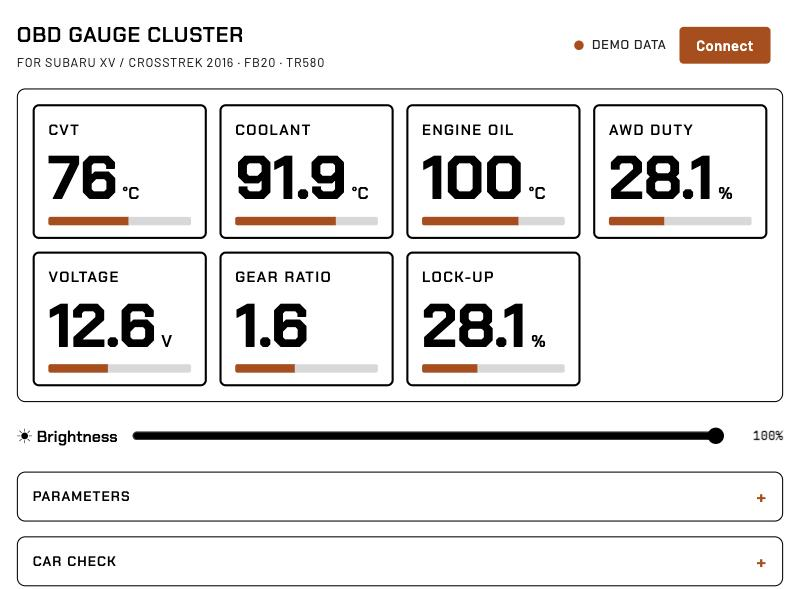

# subaru-obd2-gauge

A live gauge cluster for your phone that reads a Subaru over OBD2 with a cheap Bluetooth adapter. It shows CVT temperature, coolant, engine oil, voltage, AWD duty, CVT ratio and lock-up, and logs every drive to a CSV file.

It is one HTML file. You don't install anything, there's no account, and nothing leaves your phone.

**Use it:** https://subaru-obd2-gauge.vercel.app



> **Read-only, by design.** The page can only send read requests. Commands that clear trouble codes (mode 04 / 14) or write anything are blocked in code. On these cars, clearing codes also wipes the learned throttle values, and the engine may not idle until they are relearned.
>
> No warranty. You use it at your own risk. Not affiliated with or endorsed by Subaru.

## What you need

- **A BLE OBD2 adapter (ELM327).** Tested with the Vgate iCar Pro BLE (advertises as `IOS-Vlink`). Wi-Fi adapters and "classic" Bluetooth adapters won't work, because browsers can only reach Bluetooth Low Energy.
- **A browser with Web Bluetooth:**
  - **iPhone / iPad:** the free Bluefy browser from the App Store. Safari and Chrome on iOS have no Bluetooth access.
  - **Android, Mac, Windows, Linux:** Chrome or Edge.
- The adapter takes one connection at a time. Close other OBD apps before you connect.

## How to use

1. Plug in the adapter and start the engine.
2. Open the page and tap **Connect**. Pick the adapter in the browser's list.
3. Drive. Tiles turn amber or red past their limits, and the screen stays on while connected.
4. After the drive, open **Session log** and tap **Share / save** (or **Download CSV**). The log is kept on the phone, so a dropped connection or a reload loses nothing.

Other panels:

- **Car check:** confirms the link and the VIN, and lists which standard readings the car supports.
- **Find a parameter:** walks the manufacturer-specific readings to discover new codes.
- **Parameters:** edits names, formulas and limits.
- **Terminal:** for raw read requests.

## Verified codes

These are verified on a **2016 Subaru XV / Crosstrek 2.0i, FB20 engine, TR580 CVT** (CAN 11-bit 500k, `ATSP6`). Each code was checked against ActiveOBD on the same car unless noted.

| Reading | Header | Request | Formula | Notes |
|---|---|---|---|---|
| CVT fluid temp | 7E1 | 2210D2 | A-50 °C | `221017` (often quoted online) is **not** supported on this TCU |
| AWD duty | 7E1 | 2210C9 | A/2 % | 0 in P, ~33 % in D |
| CVT ratio | 7E1 | 22113E | (A*256+B)/256 | 2.54 at rest → ~0.6 cruising |
| Lock-up duty | 7E1 | 2210C8 | A/2 % | 0 below ~15 km/h, full when cruising. Formula by analogy, not yet checked vs ActiveOBD |
| Coolant | 7E0 | 0105 | A-40 °C | standard |
| Engine oil | 7E0 | 015C | A-40 °C | standard |
| Voltage | 7E0 | 0142 | (A*256+B)/1000 V | standard |

The page also logs RPM, speed, load, throttle, intake and ambient temperature, plus a few unidentified TCU values that are still being worked out.

**Other Subarus:** the standard readings (coolant, oil, voltage) work on almost any car. The `22xxxx` codes are specific to the computer, and may differ on other years, engines or gearboxes. Use **Find a parameter** to look for them, and please share what you verify. See below.

## Add your car

The rule of this project: **no guessed codes**. A code goes in only after someone has read it on a real car and matched it against a known-good tool (ActiveOBD, SSM, a factory scan tool).

If you've verified a code on your car, [open a "New code" issue](../../issues/new?template=new-code.yml) with the model, year, engine, gearbox, request, formula and how you checked it. See [CONTRIBUTING.md](CONTRIBUTING.md).

## Run it yourself

It's a static page, so any HTTPS host works. Web Bluetooth also works on `http://localhost`. On a Mac, double-click `start.command` to serve the folder on port 8817 and open Chrome. Or run:

```bash
python3 -m http.server 8817 --bind localhost
```

## License

MIT © Netanel Liani
